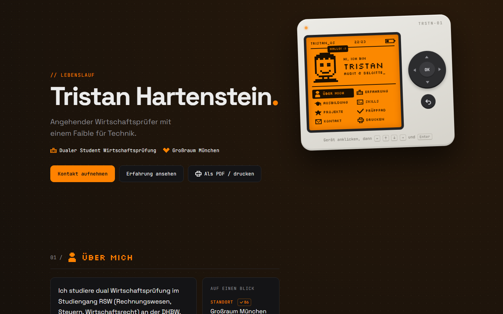

# cv-website

[](https://github.com/Tristan-sketch/cv-website/actions/workflows/pages.yml)


[](LICENSE)

My CV as a website, built with Python and Flask. The design is inspired by small hacker gadgets: a dark page, an orange pixel screen and a d-pad you can actually use.

**Live: [tristan-sketch.github.io/cv-website](https://tristan-sketch.github.io/cv-website)**



## Highlights

- **A device you can operate.** The pixel screen has a menu that works with the d-pad, the arrow keys and Enter.
- **Every claim has a source.** Each entry in the CV points to its evidence. The page lists these as an audit trail ("Prüfpfad") with references like B1, the way an auditor documents findings.
- **No dependencies in the browser.** Plain HTML, CSS and a small script; fonts are self-hosted, so no third-party requests and no cookies.
- **Content separate from code.** All texts live in one Python file; pixel art is drawn as rows of `#` and `.`.
- **Static deployment.** `build.py` renders the Flask app into plain files, and GitHub Actions publishes them to GitHub Pages on every push.

## Run it locally

```bash
python -m venv .venv
.venv\Scripts\activate          # Windows; on macOS/Linux: source .venv/bin/activate
pip install -r requirements.txt
python app.py
```

Open [http://127.0.0.1:5000](http://127.0.0.1:5000).

## Change the content

All texts live in [`cv_data.py`](cv_data.py): profile, skills, experience, projects, education and contact links.

The pixel art (avatar and icons) is drawn in [`pixel_art.py`](pixel_art.py) as rows of `#` and `.`. Change a row and the drawing changes.

`SITE_URL` (link previews and the print footer), `HOSTING_PROVIDER` and the optional `IMPRESSUM` are also set in `cv_data.py`.

## Images

`python make_images.py` draws the link preview (`static/og.png`) and the favicon from the same pixel sprites, with a small built-in pixel font. Run it again after changing the avatar.

## Build and deploy

```bash
python build.py
```

This writes plain HTML and CSS into `build/`, which any static host can serve. Pushing to `main` runs [`.github/workflows/pages.yml`](.github/workflows/pages.yml), which builds the site and deploys it to GitHub Pages.

## Project structure

```
app.py          # Flask app: menu, audit trail, study progress, screen readouts
cv_data.py      # All content of the CV, its sources and the glossary
pixel_art.py    # Pixel sprites, rendered as SVG
make_images.py  # Draws og.png and the favicon with Pillow
build.py        # Renders the site into build/
templates/      # HTML templates (Jinja): CV page and privacy page
static/         # CSS, local fonts (OFL), images and a small script for the device
```

## License

The code is released under the [MIT License](LICENSE). The personal content of the CV is not licensed for reuse, and the fonts are under the SIL Open Font License; see [NOTICE](NOTICE).
